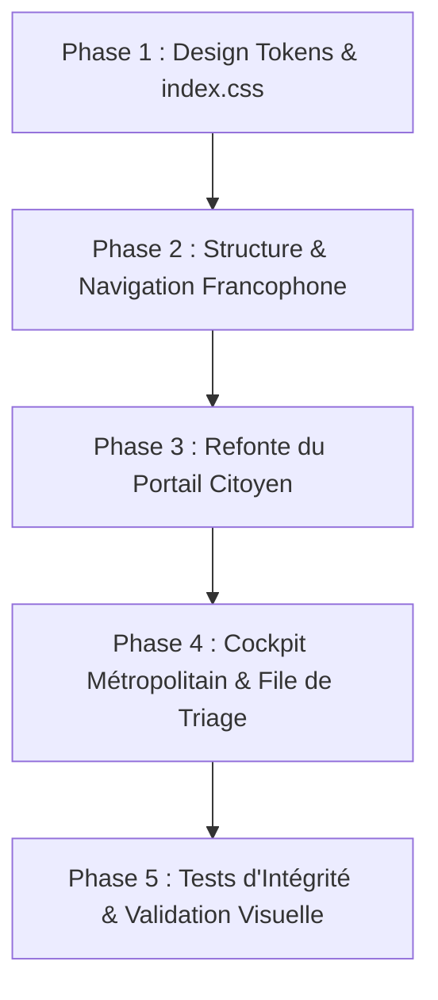

# 🇫🇷 PROFESSIONAL UPGRADE PLAN: Smart City Municipal Interface (Member 5)
**Projet:** Système d'Automatisation des Signalements Municipaux par IA (Membre 5 : Application Web, Tableau de Bord Opérationnel & Base de Données PostgreSQL)  
**Document de Référence:** `FINAL_AUDIT_MEMBER5.md`  
**Objectif:** Modernisation UX/UI de classe professionnelle, entièrement francisée, respectant les standards des portails civiques métropolitains (GovTech / Smart City).

---

## 1. Vision & Philosophie de Conception

L'objectif de cette mise à niveau est de transformer l'interface actuelle en une plateforme numérique métropolitaine d'exception, digne des plus grandes métropoles francophones (Paris, Lyon Métropole, Genève, Casablanca). 

L'expérience utilisateur s'articule autour de deux piliers fondamentaux :
1. **Le Portail Citoyen ("Guichet Numérique des Incidents Urbains") :** Accessible, transparent, pédagogique et valorisant l'action citoyenne, avec géolocalisation fluide, suivi d'intervention en direct et respect total de la vie privée.
2. **Le Tableau de Bord Métropolitain ("Cockpit des Opérations et de Triage") :** Conçu pour les agents et chefs de service municipaux, optimisé pour la prise de décision rapide, le traitement des files de modération (*Human-in-the-Loop*), l'auditabilité réglementaire immuable et la gestion des SLA d'intervention.

---

## 2. Charte Graphique & Système de Design ("Smart City")

### 2.1 Palette Chromatique Harmonisée & Sémantique
Le design abandonne les couleurs primaires génériques pour une palette élégante, institutionnelle et chaleureuse :

* **Bleu Métropole Profond (Primaire) :** `hsl(222, 65%, 24%)` / `hsl(217, 91%, 60%)` — Incarne l'autorité républicaine, la rigueur civique et la confiance.
* **Émeraude Résolution (Succès & Validation) :** `hsl(158, 75%, 40%)` — Signalements résolus, validation des étapes, conformité SLA.
* **Ambre Vigie (Modération & Alerte) :** `hsl(38, 92%, 50%)` — Dossiers en attente de triage humain, divergence texte-image, vigilance requise.
* **Corail Urgent (Priorité Haute / Rejet) :** `hsl(354, 85%, 56%)` — Pannes critiques, rejets réglementaires, délais dépassés.
* **Ardoise & Fond de Surface (Neutres & Dark Mode) :** 
  - Mode Clair : `hsl(210, 30%, 98%)` (fond général), blanc pur avec ombres douces multi-niveaux.
  - Mode Sombre : `hsl(224, 25%, 12%)` (surface foncée), `hsl(224, 20%, 16%)` (cartes surélevées), bordures discrètes en verre dépoli (*glassmorphism*).

### 2.2 Typographie Moderne
* **Police Principale :** `Inter`, `-apple-system`, `BlinkMacSystemFont`, `Segoe UI`.
* **Titres & Identité :** `Outfit` / `Inter Display`, graisses 600 et 700 pour une présence visuelle forte et lisible.
* **Données Techniques & Clés d'Idempotence :** `JetBrains Mono` / `Fira Code` pour les identifiants (`TKT-2026-XXXXX`, `RPT-XXXXX`).

### 2.3 Micro-Animations & Retours Tactiles
* États de survol réactifs avec transitions cubiques (`cubic-bezier(0.16, 1, 0.3, 1)`).
* Indicateurs de statut avec pulsation lumineuse (*live pulse*).
* Déroulement animé des 5 étapes du pipeline de décision n8n.
* Volet d'inspection coulissant (*drawer*) avec flou d'arrière-plan (*backdrop-filter: blur(12px)*).

---

## 3. Architecture des Composants & Fonctionnalités Détaillées

### 3.1 Portail Citoyen : Guichet Numérique des Incidents
* **Formulaire de Signalement Guidé :**
  - Sélection visuelle des typologies d'incidents avec iconographie claire :
    * 🛣️ *Voirie & Chaussée* (`ROAD_DAMAGE`)
    * 💡 *Éclairage Public* (`STREET_LIGHTING`)
    * 🗑️ *Propreté & Déchets* (`WASTE`)
    * 💧 *Réseaux d'Eau & Fuites* (`WATER_LEAK`)
  - Module de géolocalisation assistée avec coordonnées GPS et saisie d'adresse intelligente.
  - Téléversement de preuve photographique avec contrôle strict des formats (JPEG, PNG, WebP) et rappel visible de protection de la vie privée (floutage/anonymisation).
  - Sélecteur de cas de démonstration pré-configurés pour tester instantanément les scénarios réglementaires (Pass, Divergence, Rejet, Panne RAG).
* **Visualisation du Traitement & Pipeline en Temps Réel :**
  - Restitution animée des 5 étapes d'instruction :
    1. *Vérification du Format & Intégrité* (`INPUT_CHECK`)
    2. *Validation Intake & Vie Privée* (`GATE_1_INTAKE`)
    3. *Analyse Visuelle de Cohérence* (`GATE_2_VISION`)
    4. *Interrogation RAG des Procédures* (`GATE_3_KNOWLEDGE`)
    5. *Enregistrement Officiel du Ticket* (`PERSISTED`)
  - Badges explicatifs clairs en français pour chaque décision (`VALIDÉ`, `EN ATTENTE DE VALIDATION HUMAINE`, `REJETÉ POUR INCOMPLÉTUDE`).
* **Suivi de Ticket Citoyen :**
  - Moteur de recherche par numéro de ticket ou identifiant de signalement.
  - Chronologie d'intervention affichant les étapes de prise en charge par les équipes municipales.

### 3.2 Tableau de Bord Métropolitain : Cockpit des Opérations
* **Barre d'Administration & Sécurité :**
  - Indicateur d'état d'authentification agent avec modal de saisie sécurisée du jeton sans stockage en dur.
  - Sélecteur de mode d'orchestration n8n (Live vs Simulation) réservé aux agents authentifiés avec alerte de non-basculement silencieux.
* **Cockpit des Indicateurs de Performance (KPIs) :**
  - Compteurs temps réel synchronisés avec PostgreSQL :
    * *Total des Signalements Enregistrés*
    * *Dossiers en File de Modération Humaine*
    * *Interventions en Cours d'Exécution*
    * *Taux de Résolution Conforme*
* **Gestionnaire Avancé des Tickets :**
  - Filtrage multicritères dynamique (Département, Catégorie, Gravité, Statut).
  - Recherche instantanée par mots-clés (voie, description, identifiant).
  - Badges de gravité colorés (`FAIBLE`, `MOYENNE`, `ÉLEVÉE`).
* **Volet Coulissant d'Inspection & Journal d'Audit :**
  - Consultation exhaustive des métadonnées du signalement (preuve, localisation, délai SLA).
  - Formulaire de mise à jour du statut réservé aux agents (`REÇU` $\rightarrow$ `ASSIGNÉ` $\rightarrow$ `EN COURS` $\rightarrow$ `RÉSOLU`).
  - Champ de saisie obligatoire pour le motif ou le compte-rendu d'intervention de l'agent.
  - Journal d'audit complet et infalsifiable extrait de la table PostgreSQL `ticket_events`.
* **File de Triage des Cas Détectés (*Human-in-the-Loop*) :**
  - Interface dédiée pour les dossiers retenus par la Porte 2 (mismatch photo-texte) ou la Porte 3.
  - Présentation détaillée des motifs de suspension (`IMAGE_TEXT_MISMATCH_OR_UNCLEAR`, `MISSING_SOURCE`, etc.).
  - Boutons d'action pour approuver le signalement en ticket officiel ou classer sans suite avec justification administrative.
* **Cartographie Interactive de Transparence Civique :**
  - Vue cartographique thermique et par points géolocalisés des interventions actives dans la métropole.

---

## 4. Plan de Déploiement en 5 Phases

### Phase 1 : Système de Design & Tokens CSS (`apps/frontend/src/index.css`)
- [ ] Refonte complète de la feuille de style avec variables CSS modernes.
- [ ] Définition des palettes institutionnelles claires et sombres.
- [ ] Conception des classes utilitaires pour les badges d'état, boutons, cartes surélevées et volets.

### Phase 2 : Navigation & En-tête Métropolitain (`Navbar.tsx` & `App.tsx`)
- [ ] Refonte de la barre de navigation avec identité visuelle "Services Municipaux & Smart City".
- [ ] Intégration du sélecteur de rôle (Portail Citoyen vs Espace Métropole).
- [ ] Bannière de transparence réglementaire explicitant l'honnêteté des données et l'absence d'IA non vérifiée.

### Phase 3 : Portail Citoyen (`ReportForm.tsx`, `SubmissionResult.tsx`, `TicketTracker.tsx`)
- [ ] Francisation intégrale de tous les champs, libellés et infobulles.
- [ ] Modernisation du téléverseur de photos avec aperçu instantané et mention RGPD / vie privée.
- [ ] Refonte esthétique de la jauge d'étapes décisionnelles du pipeline n8n.
- [ ] Interface de suivi de ticket responsive avec horodatage en français.

### Phase 4 : Cockpit des Opérations (`KpiCards.tsx`, `TicketTable.tsx`, `TicketDetailDrawer.tsx`, `ReviewQueue.tsx`, `StaffAuthModal.tsx`)
- [ ] Francisation des colonnes, filtres, statuts et alertes.
- [ ] Intégration ergonomique de la modal d'authentification agent avec mémorisation de session.
- [ ] Refonte de la file de triage avec mise en exergue des motifs techniques traduits en langage métier.
- [ ] Modernisation du volet d'audit des événements historiques PostgreSQL.

### Phase 5 : Validation & Assurance Qualité
- [ ] Exécution complète de la suite de tests automatisés (71 assertions).
- [ ] Vérification de la compilation TypeScript et du build de production Vite.
- [ ] Validation de l'ergonomie responsive et du contraste d'accessibilité (WCAG AA).

---

## 5. Directives de Non-Régression Technique

Afin de préserver l'intégrité validée lors de l'audit final :
1. **Zéro altération des contrats d'API :** Les endpoints backend (`POST /api/municipal-ticket`, `GET /api/tickets`, `PATCH /api/tickets/:id/status`, `GET/PATCH /api/reviews`, etc.) et les payloads JSON restent strictement identiques.
2. **Pérennité de la persistance PostgreSQL :** Aucune modification destructive de schéma de base de données.
3. **Sécurité et anonymisation garanties :** L'authentification par jeton d'environnement et la protection des médias non anonymisés sont maintenues sans concession.
4. **Honnêteté intellectuelle continue :** Aucune fausse affirmation d'inférence neuronale temps réel lors de l'exécution en mode mock.
