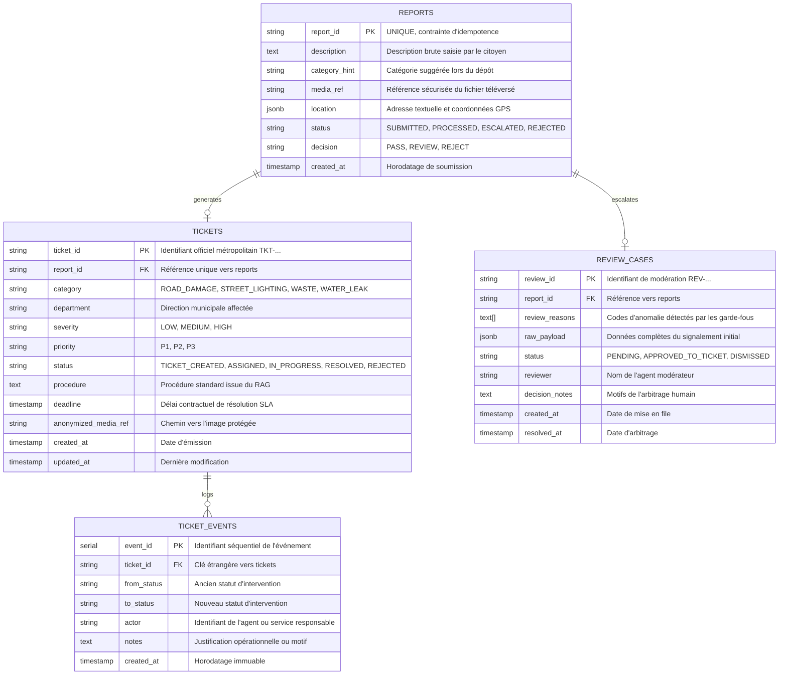

# Architecture Système & Conception Technique — Membre 5

Ce document présente l'architecture logicielle, le modèle de données PostgreSQL et les mécanismes d'intégration développés par Membre 5.

---

## 1. Vue d'Ensemble de l'Architecture en Couches

L'application de Membre 5 s'organise selon une architecture découplée en 4 couches garantissant la séparation des responsabilités :

```
┌────────────────────────────────────────────────────────────────────────┐
│                        COUCHE PRÉSENTATION (React 18)                 │
│                                                                        │
│   [Guichet Citoyen]                       [Cockpit des Opérations]     │
│   • Formulaire 4 Catégories               • 4 KPIs Calculés en Direct  │
│   • Téléversement & RGPD                  • Registre Tickets & Filtres │
│   • Détection Coordonnées GPS             • File Modération Humaine    │
│   • Traçabilité n8n & Timeline            • Panneau Latéral & RAG SLA  │
└────────────────────────────────────┬───────────────────────────────────┘
                                     │ HTTP / REST / JSON
                                     ▼
┌────────────────────────────────────────────────────────────────────────┐
│                        COUCHE API (Express.js / Node.js)               │
│                                                                        │
│   • Routeur Ingestion : /api/reports, /api/municipal-ticket            │
│   • Routeur Opérations : /api/tickets, /api/reviews, /api/stats        │
│   • Routeur Authentification : /api/auth/login, /api/auth/verify       │
│   • Routeur Téléversement : /api/upload, /api/uploads                  │
│   • Middleware Sécurité : Bearer Token Check (STAFF_AUTH_TOKEN)        │
│   • Middleware RGPD : Blocage d'accès public aux photos brutes         │
└──────────────────┬─────────────────────────────────┬───────────────────┘
                   │                                 │
                   ▼ (1) Orchestration n8n           ▼ (2) Persistance ACID
┌──────────────────────────────────────┐   ┌─────────────────────────────┐
│       MOTEUR D'ORCHESTRATION         │   │   BASE DE DONNÉES           │
│                                      │   │   PostgreSQL 14 (Port 5432) │
│  • Mode En Direct (N8N_MODE=live) :  │   │                             │
│    Appel HTTP POST sur webhook n8n   │   │   • reports (Signalements)  │
│  • Mode Déterministe (mock) :        │   │   • tickets (Tickets offic.)│
│    Simulateur 20 nœuds conforme      │   │   • ticket_events (Audit)   │
│    aux fixtures de Membre 1          │   │   • review_cases (Escalades)│
└──────────────────────────────────────┘   └─────────────────────────────┘
```

---

## 2. Modèle de Données & Schéma PostgreSQL

Le schéma relationnel normalisé est conçu pour garantir l'intégrité référentielle, la traçabilité immuable et la conformité ACID :



---

## 3. Mécanisme d'Idempotence & Prévention des Doublons

Pour éviter que des doubles-clics citoyens ou des renvois automatiques de paquets réseau ne polluent le registre municipal, l'ingestion applique une vérification transactionnelle stricte :
1. Chaque signalement possède un identifiant `report_id` unique garanti par la contrainte SQL `UNIQUE(report_id)`.
2. À la réception d'une requête `POST /api/reports`, le backend effectue un `SELECT ticket_id FROM tickets WHERE report_id = $1`.
3. Si un ticket existe déjà pour ce `report_id`, le système renvoie immédiatement le ticket persistant existant en statut `HTTP 200 OK` sans exécuter de nouvel appel d'IA ni insérer de doublon.

---

## 4. Machine à États & Journal d'Audit Immuable

Les tickets municipaux suivent un cycle de vie contrôlé :
```
[TICKET_CREATED] ──> [ASSIGNED] ──> [IN_PROGRESS] ──> [RESOLVED]
       │                                                     ▲
       └──────────────────> [REJECTED] ──────────────────────┘
```

Chaque transition d'état appelle la méthode `updateTicketStatus(ticketId, newStatus, actor, notes)` qui :
1. Exécute la mise à jour atomique `UPDATE tickets SET status = $1, updated_at = NOW() WHERE ticket_id = $2`.
2. Insère instantanément une ligne dans la table append-only `ticket_events` enregistrant l'ancien statut, le nouveau statut, le nom de l'agent et ses notes.
3. Cette table ne possède **aucun endpoint de modification (`UPDATE`) ni de suppression (`DELETE`)**, garantissant un historique inviolable en cas de litige administratif.
